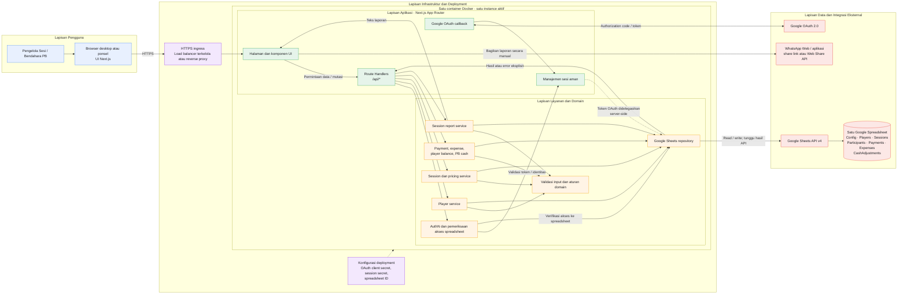

# Spesifikasi Arsitektur Epic: Pencatatan Sesi Bermain Badminton

## 1. Epic Architecture Overview

Epic dibangun sebagai aplikasi web Next.js App Router satu layanan. UI, API server, autentikasi, logika domain, dan integrasi data berjalan dalam satu aplikasi TypeScript. Satu Google Spreadsheet menjadi sumber data bisnis utama, dengan tab terpisah untuk pemain, sesi, peserta, pembayaran, pengeluaran, penyesuaian kas, dan konfigurasi.

Pengguna masuk menggunakan Google OAuth. Operasi terhadap spreadsheet dilakukan di server dengan token OAuth pengguna, sehingga Google Sheets tetap menegakkan izin berbagi yang sudah diberikan pemilik spreadsheet. Setiap permintaan data memverifikasi sesi pengguna; permintaan ke spreadsheet yang tidak diizinkan ditolak. Penulisan menunggu konfirmasi Google Sheets sebelum UI menampilkan status berhasil.

Arsitektur sengaja tidak memakai database, cache, antrean, atau worker terpisah pada MVP. Skala awal adalah satu PB dan satu spreadsheet. Untuk menjaga integritas data finansial, aplikasi menggunakan penulisan terurut dan idempotensi; deployment MVP dibatasi pada satu instance aktif. Google Sheets bukan database transaksional, sehingga dukungan banyak instance atau volume tinggi memerlukan keputusan arsitektur lanjutan.

### Batas konteks domain

- **Akses:** login Google, validasi sesi, dan pemeriksaan izin spreadsheet.
- **Pemain:** profil dan status aktif/nonaktif pemain.
- **Sesi:** sesi, peserta, harga, jumlah bola, jumlah game, dan perhitungan tagihan.
- **Keuangan:** pembayaran, pengeluaran PB, saldo pemain, serta saldo kas.
- **Laporan:** ringkasan sesi yang ditampilkan dan dibagikan sebagai teks.
- **Google Sheets:** adapter baca/tulis yang menjadi batas tunggal antara domain aplikasi dan spreadsheet.

## 2. System Architecture Diagram

### Alur utama

1. **Login:** Browser diarahkan ke Google OAuth; callback memvalidasi respons OAuth dan membuat sesi aplikasi yang aman. Aplikasi menggunakan token OAuth pengguna di server, bukan kredensial service account yang melewati izin berbagi pengguna.
2. **Otorisasi:** Sebelum operasi data, server memvalidasi sesi dan memastikan pengguna dapat mengakses spreadsheet yang dikonfigurasi. Kegagalan izin dari Google diterjemahkan menjadi akses ditolak, bukan data kosong.
3. **Baca:** Route Handler memanggil layanan domain, yang membaca tab terkait melalui repository Google Sheets. Data finansial tidak diambil dari cache aplikasi.
4. **Tulis:** Layanan memvalidasi aturan dan menghitung nilai turunan, lalu repository menulis ke Google Sheets. UI hanya menampilkan sukses setelah API mengonfirmasi penulisan; setelahnya UI mengambil ulang data terbaru.
5. **Bagikan laporan:** Server menghasilkan teks laporan sesi; pengguna memilih untuk membukanya atau membagikannya melalui WhatsApp. Tidak ada pengiriman otomatis atau integrasi WhatsApp Business API.

### Struktur tab Google Spreadsheet

| Tab | Tanggung jawab | Data utama |
|---|---|---|
| `Config` | Pengaturan spreadsheet | Versi skema, mata uang, saldo awal PB |
| `Players` | Data pemain | ID stabil, nama, status aktif, waktu dibuat/diubah |
| `Sessions` | Sesi bermain dan harga | ID sesi, tanggal/waktu, biaya lapangan per pemain, harga bola, status |
| `Participants` | Keikutsertaan dan tagihan | ID sesi, ID pemain, jumlah bola, jumlah game, biaya terhitung |
| `Payments` | Penerimaan pembayaran | ID transaksi, ID pemain, ID sesi opsional, nominal, waktu, catatan, kunci idempotensi |
| `Expenses` | Pengeluaran PB | ID transaksi, nominal, waktu, kategori/catatan, kunci idempotensi |
| `CashAdjustments` | Koreksi saldo awal/penyesuaian kas | ID transaksi, nominal bertanda, waktu, alasan, referensi transaksi opsional, kunci idempotensi |

ID dibuat oleh aplikasi dan disimpan sebagai nilai, bukan nomor baris. Nomor baris spreadsheet tidak boleh dipakai sebagai identitas karena dapat berubah saat baris disisipkan atau diurutkan. Nilai uang disimpan sebagai bilangan bulat Rupiah. Kolom ID dan header tab harus divalidasi saat aplikasi mulai digunakan.

## 3. High-Level Features & Technical Enablers

### Fitur tingkat tinggi

- **Dashboard:** ringkasan sesi, pemain, saldo pemain, dan saldo kas PB.
- **Manajemen pemain:** tambah dan ubah profil, tandai nonaktif, lihat riwayat sesi serta saldo.
- **Manajemen sesi:** buat sesi dengan harga lapangan dan bola, tambah peserta terdaftar, catat jumlah bola dan game.
- **Perhitungan biaya:** tagihan peserta = biaya lapangan per pemain + (harga bola × jumlah bola pemain). Jumlah game hanya statistik.
- **Transaksi pemain:** catat pembayaran kapan saja, baik tertaut ke sesi maupun tanpa sesi; saldo pemain kumulatif menunjukkan kurang bayar atau kredit.
- **Keuangan PB:** catat pembayaran yang diterima dan pengeluaran PB; saldo kas = saldo awal + pemasukan aktual − pengeluaran.
- **Laporan sesi:** tampilkan peserta, jumlah bola/game, rincian biaya, pembayaran, serta status saldo; bagikan teks melalui WhatsApp.
- **Penyimpanan langsung:** mutasi tersimpan ke Google Sheets sebelum UI mengonfirmasi keberhasilan.
- **Pembatasan akses:** hanya akun Google yang memiliki akses spreadsheet dapat membaca atau mengubah data aplikasi.

### Technical enablers

- **Modul domain TypeScript:** modul Access, Players, Sessions, Ledger, Reports, dan Google Sheets Integration dengan batas tanggung jawab jelas.
- **Google OAuth per pengguna:** authorization-code flow, validasi `state`, sesi aman, refresh token yang dilindungi, dan scope minimum untuk identitas serta akses spreadsheet.
- **Pemeriksaan izin server-side:** verifikasi akses ke spreadsheet saat login dan saat operasi; tangani pencabutan izin/token dan respons `403` dari Google secara eksplisit.
- **Sheets repository:** satu adapter server-side untuk operasi Sheets API v4, pemetaan tab-ke-entitas, parsing nilai, dan penanganan kuota/error.
- **Validasi skema spreadsheet:** pemeriksaan tab, header, versi skema, ID stabil, dan format nilai saat runtime; sediakan instruksi bootstrap manual untuk spreadsheet awal.
- **Validasi input terpusat:** skema validasi bertipe untuk harga dan nominal nonnegatif, pemain/sesi wajib terdaftar, dan pencegahan peserta duplikat. Zod dapat dipakai bila disetujui saat implementasi.
- **Logika finansial deterministik:** fungsi teruji untuk biaya sesi, saldo pemain, laporan sesi, dan saldo PB; UI tidak menjadi sumber perhitungan utama.
- **Jurnal transaksi append-only:** pembayaran dan pengeluaran ditambahkan sebagai baris transaksi baru; koreksi dilakukan lewat transaksi koreksi atau prosedur yang mempertahankan jejak, bukan menghapus riwayat.
- **Idempotensi dan serialisasi:** setiap mutasi finansial memiliki operation ID yang stabil. Satu instance aktif mengurutkan operasi tulis dan memeriksa ID yang telah tersimpan sebelum mengulang mutasi.
- **Perilaku gagal yang jelas:** tampilkan error Google API dan pertahankan input yang belum tersimpan untuk dicoba ulang; jangan memberi status sukses berbentuk fallback.
- **Berbagi laporan:** pembentukan teks laporan dan Web Share API atau tautan WhatsApp dengan teks yang dienkode; pengguna harus melakukan aksi berbagi secara eksplisit.
- **Konfigurasi deployment:** rahasia OAuth, kunci enkripsi sesi, dan spreadsheet ID di environment/secret manager deployment, tidak di repository atau Google Sheet.
- **Pengujian:** unit test untuk kalkulasi domain; integration test repository dengan Google API mock; acceptance test untuk alur izin, pembayaran kurang/lebih, dan laporan.

### Konsistensi dan batasan Google Sheets

- Setiap perubahan finansial dicatat sebagai transaksi terlebih dahulu; saldo diturunkan dari tagihan dan jurnal pembayaran/pengeluaran.
- Pengiriman ke Google Sheets bersifat sinkron terhadap permintaan pengguna. Tidak ada antrean offline atau worker latar pada MVP.
- Operasi yang dapat ditulis dalam satu request batch harus dikelompokkan, tetapi Google Sheets tidak menyediakan transaksi database umum, batasan unik, atau locking lintas instance.
- Untuk MVP, jalankan satu instance aktif dan serialisasikan mutasi pada instance tersebut. Kunci idempotensi yang disimpan bersama transaksi membantu mencegah duplikasi saat retry.
- Mutasi spreadsheet manual di luar aplikasi tidak memiliki notifikasi push yang dijamin; data dibaca ulang dari Sheets pada permintaan aplikasi berikutnya.
- Jangan menambah replica aplikasi atau menjalankan di lingkungan serverless multi-instance tanpa mekanisme koordinasi lintas instance dan evaluasi ulang konsistensi.
- Jika skala atau kebutuhan ketersediaan melampaui batas ini, perubahan dari Google Sheets ke database transaksional memerlukan keputusan produk/arsitektur baru karena bertentangan dengan persyaratan satu spreadsheet sebagai sumber data utama.

## 4. Technology Stack

### Dipakai atau direkomendasikan

- **Bahasa:** TypeScript.
- **Web framework:** Next.js App Router dan React, mengikuti struktur repository saat ini.
- **API:** Next.js Route Handlers dengan tipe request/response bersama. tRPC tidak diperlukan untuk MVP satu aplikasi; pertimbangkan hanya jika kebutuhan client/API berkembang.
- **Autentikasi dan izin:** Google OAuth 2.0 dengan akses delegated per pengguna ke Google Sheets API. Stack Auth tidak digunakan sebagai pengganti pemeriksaan izin spreadsheet, karena identitas Stack Auth saja tidak membuktikan akses pengguna ke spreadsheet.
- **Penyimpanan bisnis:** Google Sheets API v4, satu spreadsheet dengan tab yang ditentukan di atas.
- **Validasi:** validasi skema TypeScript di server; Zod merupakan opsi, bukan dependency yang sudah terpasang.
- **Deployment:** satu Docker image aplikasi Next.js. Dapat dijalankan pada VM/container terkelola untuk self-hosted atau SaaS; gunakan reverse proxy/load balancer dan TLS pada lapisan deployment.
- **Berbagi:** Web Share API atau tautan WhatsApp Web/Deep Link dengan teks laporan yang disiapkan aplikasi.
- **Pengujian:** framework test TypeScript yang dipilih saat implementasi, mencakup unit domain, integrasi API Google yang dimock, dan alur browser.

### Tidak diperlukan untuk MVP

- **PostgreSQL:** tidak digunakan karena seluruh data bisnis diwajibkan berada dalam satu Google Spreadsheet.
- **Redis:** tidak digunakan; tidak ada cache atau antrean. Sesi autentikasi harus dikelola tanpa membuka akses lintas pengguna.
- **Qdrant/vector database:** tidak ada kebutuhan pencarian semantik.
- **n8n/workflow engine/background worker:** tidak ada workflow asinkron yang diminta.
- **Turborepo/monorepo:** repository saat ini merupakan satu aplikasi Next.js; pemecahan menjadi monorepo belum memberi manfaat untuk ruang lingkup epic.
- **Stack Auth:** tidak dipakai karena akses aplikasi harus mengikuti izin Google Sheets pengguna, bukan hanya status login pada provider autentikasi lain.

## 5. Technical Value

**Tinggi.** Arsitektur membentuk satu jalur data yang mudah dipahami, menjaga Google Sheets sebagai referensi utama, serta memisahkan aturan biaya dan saldo dari UI agar dapat diuji. Batasan akses delegated OAuth mencegah aplikasi memberi akses melalui kredensial bersama yang melewati izin spreadsheet. Batas satu instance dan pencatatan transaksi yang dapat ditelusuri mengurangi risiko konsistensi untuk skala MVP, sambil membuat keterbatasan Sheets terlihat sejak awal.

## 6. T-Shirt Size Estimate

**L (Large).** Walaupun deployment hanya satu aplikasi dan satu sumber data, epic mencakup OAuth Google dengan akses delegated, integrasi Sheets, pemodelan transaksi, saldo lintas sesi, perlindungan dari retry, empat area UI, laporan, dan pengujian finansial. Estimasi mengasumsikan satu PB, satu spreadsheet, satu mata uang, dan satu instance aktif. Multi-tenant, offline mode, pemrosesan pembayaran digital, serta deployment multi-instance tidak termasuk estimasi ini.
