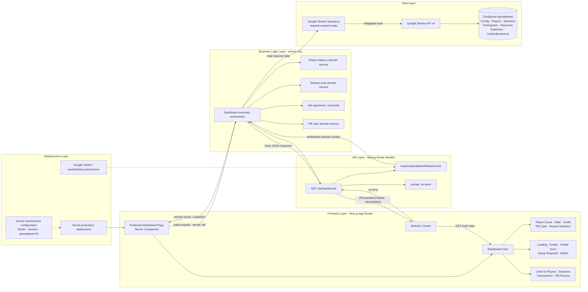
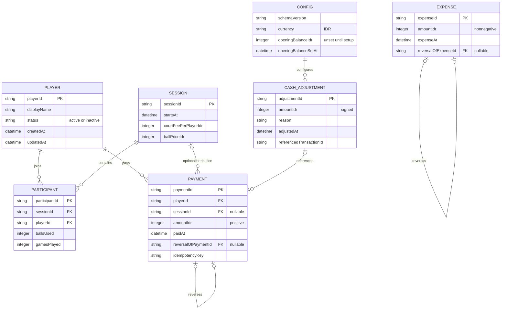
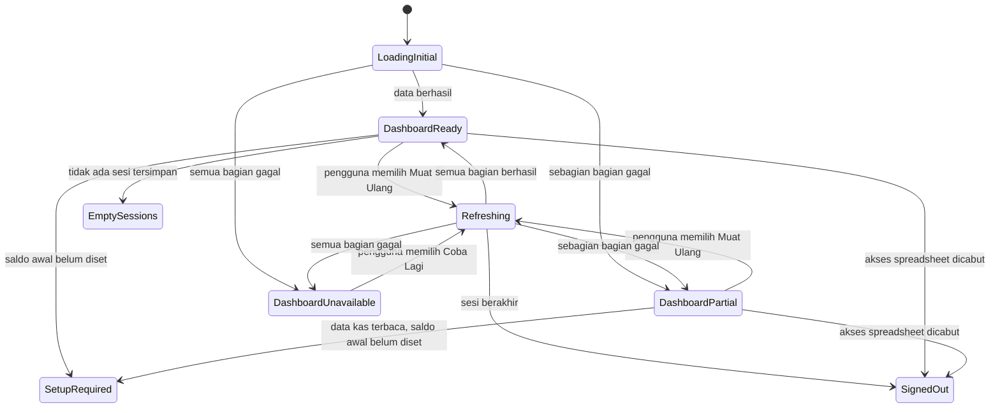

# Dashboard Ringkasan Sesi dan Keuangan — Rencana Implementasi

## Tujuan

Menyediakan Dashboard baca-saja yang merangkum pemain aktif, kekurangan dan kredit pemain, posisi kas PB, serta lima sesi terbaru dari Google Sheets. Semua angka finansial harus berasal dari data terbaru yang berhasil dibaca dan dihitung memakai aturan domain yang sama dengan fitur Pemain, Sesi, Pembayaran, dan Keuangan PB. Kegagalan pada sumber data harus terlihat jelas dan tidak boleh berubah menjadi angka nol atau nilai lama tanpa penanda. Dashboard memberi tautan ke menu detail, tetapi tidak menulis atau mengubah data.

## Ketergantungan dan Prasyarat

- Fitur [Login Google dan Izin Akses Google Sheets](../google-sheets-access/prd.md) menyediakan sesi server-side, verifikasi akses baca, dan pembedaan viewer/editor.
- Fitur [Manajemen Pemain dan Saldo Pemain](../player-management-and-balances/prd.md) menyediakan daftar pemain serta kalkulasi saldo berdasarkan tagihan dan pembayaran bersih.
- Fitur [Pembuatan Sesi, Peserta, dan Perhitungan Biaya](../session-management/prd.md) menyediakan data sesi, peserta, dan perhitungan tagihan.
- Fitur [Pencatatan Pembayaran dan Saldo Pemain](../player-payments/prd.md) menyediakan jurnal pembayaran, reversal, serta pembayaran bersih per pemain dan sesi.
- Fitur [Keuangan PB dan Saldo Kas](../pb-finance/prd.md) menyediakan saldo awal, pengeluaran, penyesuaian, dan kalkulasi saldo kas.
- Sebelum implementasi, verifikasi layanan domain dan kontrak Google Sheets dari fitur-fitur tersebut benar-benar tersedia. Dashboard tidak boleh membuat ulang rumus yang belum tersedia atau membaca struktur spreadsheet yang belum disepakati.
- Google Sheets tidak memberi snapshot transaksi lintas tab. Data dibaca ulang pada setiap permintaan, namun perubahan manual bersamaan dapat menyebabkan tab terbaca pada waktu yang sedikit berbeda; batasan ini harus tetap terdokumentasi.

## Persyaratan

### Persyaratan Fitur

- Tampilkan jumlah pemain aktif; pemain nonaktif tidak termasuk hitungan ini.
- Tampilkan total kekurangan bayar dan total kredit lebih bayar sebagai dua angka terpisah. Keduanya mencakup pemain aktif maupun nonaktif; saldo nol tidak menambah kedua total.
- Tampilkan saldo kas kumulatif berdasarkan saldo awal + pembayaran bersih − pengeluaran bersih + penyesuaian kas bersih. Jika saldo awal belum ditetapkan, tampilkan status setup, bukan saldo final nol.
- Tampilkan hingga lima sesi terbaru, diurutkan berdasarkan waktu sesi terbaru terlebih dahulu dengan ID sesi sebagai pemutus seri.
- Setiap sesi menampilkan waktu, jumlah peserta saat ini, total tagihan, serta pembayaran bersih yang ditautkan secara eksplisit ke sesi. Pembayaran tanpa sesi tidak ikut; pembayaran tertaut tetap dihitung setelah reversal sekalipun pemain tidak lagi menjadi peserta aktif saat ini.
- Tampilkan tautan yang jelas menuju detail Pemain, Sesi, Transaksi, dan Keuangan PB.
- Tampilkan waktu data berhasil dimuat. Jika sumber gagal dibaca atau tidak lengkap, tampilkan status error yang relevan dan jangan sajikan total finansial parsial sebagai nilai final.
- Bila sebagian sumber gagal, bagian yang tidak bergantung padanya boleh tetap tampil. Jika sesi atau saldo kas bergantung pada data yang tidak lengkap, seluruh angka final pada bagian tersebut harus ditahan.
- Viewer dapat membaca Dashboard. Tidak ada kontrol atau endpoint mutasi pada Dashboard; akses tulis pada menu lain tetap ditegakkan server-side.

### Spesifikasi Implementasi

- Buat satu layanan server-only `getDashboardSummary()` yang mengorkestrasi pembacaan data dan memanggil fungsi domain fitur terkait. Jangan menghitung tagihan, saldo pemain, reversal, atau saldo kas dengan aturan UI baru.
- Pisahkan hasil per bagian (jumlah pemain aktif, ringkasan saldo pemain, saldo kas PB, sesi terbaru) agar kegagalan satu sumber tidak otomatis menghapus bagian lain yang valid.
- Sumber finansial dianggap lengkap hanya jika semua tab yang diperlukan untuk rumus terkait berhasil dibaca dan diparse. Data kosong yang valid berbeda dari tab gagal dibaca atau data tidak valid.
- Baca data pada setiap pemuatan/refresh dengan cache lintas-permintaan dimatikan. Jangan memakai fallback ke nilai lama, local storage, atau nilai default nol untuk error.
- Lakukan pembacaan yang dapat berjalan independen secara paralel dalam satu permintaan. Gunakan hasil yang sama untuk seluruh agregasi dalam permintaan itu; jangan membaca ulang tab yang sama per kartu.
- Gunakan ID stabil untuk menghubungkan baris. Jangan menjadikan nomor baris Google Sheets atau nama pemain sebagai kunci.
- Semua nominal memakai bilangan bulat Rupiah. Format angka/mata uang dilakukan di UI setelah kalkulasi domain selesai.
- Untuk nilai waktu sesi yang tidak dapat diparse atau relasi yang tidak valid, jangan diam-diam mengurutkan atau menghitung dengan nilai pengganti; tandai bagian terkait sebagai data tidak valid dan laporkan melalui error aman.
- Gunakan Route Handler `GET /api/dashboard` sebagai jalur refresh data yang sama dengan initial server render. Server Component halaman memanggil layanan domain langsung agar tidak membuat HTTP request internal ke aplikasi itu sendiri.
- Setiap permintaan data harus melalui pemeriksaan sesi dan akses Google Spreadsheet yang dikonfigurasi. Endpoint tidak menerima ID spreadsheet, peran, rentang data, maupun rumus dari klien.
- Patuhi p95 ≤ 3 detik pada volume MVP satu PB dalam kondisi Google Sheets normal. Ukur dengan fixture yang mewakili volume yang disepakati; jangan mengejar target dengan cache basi yang melanggar freshness.

## Pertimbangan Teknis

### Ikhtisar Arsitektur Sistem



#### Alur Data

1. Halaman Dashboard meminta data pada server. Server memvalidasi sesi dan izin baca Google Spreadsheet sebelum meminta data bisnis.
2. `getDashboardSummary()` membaca hanya kolom yang diperlukan dari tab sumber pada permintaan tersebut. Pembacaan tab yang independen dapat berjalan paralel; tidak ada cache antarpermintaan.
3. Layanan memanggil fungsi domain bersama untuk saldo pemain, biaya sesi, pembayaran bersih, dan kas PB. Hanya sumber yang lengkap yang dapat menghasilkan total final.
4. Layanan mengembalikan status per bagian serta waktu penyusunan respons. Kesalahan Google API, data tidak valid, dan saldo awal yang belum dikonfigurasi memiliki status berbeda.
5. Server merender initial view. Kontrol refresh meminta `GET /api/dashboard`, yang menggunakan layanan dan pemeriksaan izin yang sama. UI mengganti tampilan dengan hasil terbaru; error refresh tidak boleh tampak sebagai saldo terkini.

#### Pemilihan Teknologi

| Lapisan | Pilihan | Alasan |
|---|---|---|
| UI dan routing | Next.js App Router, React, TypeScript yang sudah ada | Sesuai aplikasi tunggal yang digunakan epic; halaman dapat dirender di server dan akses data tetap terlindungi. |
| API | Next.js Route Handler `GET /api/dashboard` | Konsisten dengan arsitektur parent; cukup untuk read-only refresh, tidak menambah tRPC. |
| Domain | Layanan server-only dan fungsi kalkulasi domain dari fitur terkait | Menjaga rumus finansial satu sumber dan mencegah perhitungan berbeda di UI. |
| Sumber data | Google Sheets API v4 melalui repository yang dimiliki epic | Satu sumber data bisnis; dashboard tidak memiliki penyimpanan atau sinkronisasi sendiri. |
| Styling | Tailwind CSS yang sudah terpasang, elemen HTML semantik | Tidak perlu menambah komponen atau pustaka UI yang belum digunakan repository. |
| State UI | State lokal React untuk refresh dan status permintaan | Tidak diperlukan Zustand, React Query, atau state global untuk tampilan baca-saja ini. |
| Hosting | Vercel sebagai target deployment aplikasi | Mengikuti arsitektur epic. Pengujian fitur dijalankan lokal dengan mock/fixture dan spreadsheet disposable, bukan menjadikan Vercel target pengembangan atau pengujian rutin. |
| Database/cache | Tidak ada SQL database, Redis, cache, antrean, atau worker baru | Data sudah bersumber dari Sheets dan dashboard harus menampilkan kondisi terbaru. |

#### Titik Integrasi

- **Authentication/DAL:** gunakan `requireSpreadsheetReadAccess` dari fitur akses Google Sheets. Jangan mengandalkan layout terlindungi atau flag `canEdit` dari browser sebagai kontrol keamanan.
- **Pemain:** gunakan fungsi domain saldo yang menghitung saldo kumulatif per ID pemain dari total tagihan dan pembayaran bersih; jumlah utang dan kredit agregat tidak boleh dihitung dari saldo bersih lintas pemain.
- **Sesi:** gunakan biaya/tagihan sesi yang dihitung server-side dari sesi dan peserta tersimpan. Pembayaran sesi merupakan agregasi terpisah berdasarkan `sessionId`.
- **Pembayaran:** gunakan data pembayaran bersih setelah reversal; transaksi tanpa sesi tidak termasuk total pembayaran sesi.
- **Keuangan PB:** gunakan layanan kas bersama yang memvalidasi keberadaan saldo awal serta memasukkan reversal dan penyesuaian.
- **Navigasi:** tautkan ke route Pemain, Sesi/detail sesi, Transaksi, dan Keuangan PB yang disediakan fitur terkait. Gunakan route registry/konvensi aktual saat fitur tersebut diimplementasikan; jangan membuat halaman duplikat di Dashboard.
- **Google Sheets:** akses hanya melalui repository server-side yang sudah dikonfigurasi. Spreadsheet ID tidak boleh diterima dari klien.

#### Deployment Architecture

- Deploy sebagai bagian dari aplikasi Next.js tunggal ke target production Vercel setelah seluruh gate lokal dan integrasi data lolos.
- Gunakan konfigurasi server-side yang telah ditetapkan oleh fitur akses Google. Tidak ada rahasia OAuth, token, maupun konten spreadsheet yang dikirim ke browser.
- Endpoint dan render halaman Dashboard harus bersifat request-time dan tidak masuk ke cache publik/static Next.js. Gunakan pola uncached yang didukung versi Next.js terpasang.
- Tidak menambah Docker, service terpisah, database eksternal, atau worker. Deployment target Vercel tidak digunakan sebagai lingkungan pengembangan atau pengujian rutin.

#### Pertimbangan Skalabilitas

- Gunakan runtime stateless: seluruh konteks pengguna dan izin berasal dari sesi/token server-side yang kompatibel lintas invocation, bukan variabel global.
- Kompleksitas agregasi adalah O(n) terhadap riwayat sesi, peserta, dan transaksi yang diperlukan; pengurutan sesi O(m log m). Dashboard harus memilih kolom terbatas dan menyusun indeks `Map` berbasis ID selama satu permintaan.
- Baca sumber satu kali per permintaan dan bagikan hasilnya ke seluruh bagian. Jangan membuat request Sheets per pemain, peserta, atau kartu.
- Ukur waktu Google Sheets, pemetaan, kalkulasi, dan render secara terpisah. Bila p95 melampaui 3 detik pada volume MVP, kurangi payload/kolom dan optimalkan pembacaan dalam arsitektur yang disetujui; jangan mengembalikan cache lama sebagai data terbaru.
- Google Sheets tidak menyediakan snapshot konsisten lintas tab atau transaksi. Dashboard menampilkan `loadedAt` dan status error, namun tidak mengklaim bahwa seluruh tab merepresentasikan satu snapshot atomik.

### Desain Skema Data

Dashboard tidak menambah tabel SQL, tab spreadsheet, atau kolom bisnis. Diagram berikut adalah model logis dari data yang dibaca; struktur final tetap dimiliki fitur sumber.



#### Spesifikasi Entitas Sumber

| Tab/entitas | Field penting dan batasan | Pemakaian Dashboard |
|---|---|---|
| `Config` | Versi skema, mata uang IDR, saldo awal opsional, waktu setup. Nilai saldo awal `0` tetap berbeda dari belum diset. | Menentukan status setup dan input kas awal. |
| `Players` | ID stabil, nama, status aktif/nonaktif, waktu dibuat/diubah. | Menghitung pemain aktif dan menghubungkan saldo ke pemain; nonaktif tetap masuk total utang/kredit. |
| `Sessions` | ID stabil, waktu sesi, biaya lapangan per pemain, harga bola. | Memilih lima terbaru dan menghitung tagihan melalui domain sesi. |
| `Participants` | ID sesi, ID pemain, jumlah bola, jumlah game; relasi sesi-pemain unik sesuai fitur Sesi. | Menghitung jumlah peserta dan tagihan; game tidak memengaruhi biaya. |
| `Payments` | ID transaksi, ID pemain, ID sesi opsional, nominal integer positif, waktu, relasi reversal, kunci idempotensi. | Menghitung saldo pemain, kas, dan pembayaran bersih per sesi; reversal dikeluarkan dari nilai bersih. |
| `Expenses` | ID transaksi, nominal integer nonnegatif, waktu, referensi reversal. | Menghitung pengeluaran bersih untuk saldo kas PB. |
| `CashAdjustments` | ID transaksi, nominal integer bertanda, alasan, waktu, referensi opsional. | Menghitung penyesuaian kas bersih. |

#### Strategi Indeks dan Relasi

- Google Sheets tidak menyediakan foreign key, constraint unik, atau indeks database. Repository/domain memvalidasi relasi ID dan data yang dibutuhkan; baris/posisi sheet tidak pernah menjadi identitas.
- Buat `Map` request-scoped berdasarkan `playerId`, `sessionId`, `paymentId`, dan relasi reversal agar perhitungan tidak melakukan pencarian linear berulang.
- Gunakan indeks alami yang telah tersedia berupa ID stabil dan referensi tab. Tidak membuat tab indeks atau formula baru khusus Dashboard.
- Total keuangan hanya valid jika semua tab dependen berhasil dibaca dan struktur/header sesuai versi skema.
- Urutkan sesi berdasarkan `startsAt` menurun dan gunakan pengurutan ID stabil sebagai pemutus seri. Arah urutan ID harus konsisten pada domain dan tes; tetapkan sebelum implementasi final jika belum ditentukan oleh fitur Sesi.

#### Strategi Migrasi

- Tidak ada migrasi database, perubahan tab, atau backfill untuk Dashboard.
- Validasi header dan versi skema melalui mekanisme repository yang digunakan fitur lain. Ketidakcocokan skema harus menjadi error eksplisit pada bagian yang terdampak.
- Jika implementasi sumber kemudian membutuhkan perubahan struktur, migrasi dimiliki oleh fitur sumber dan harus kompatibel dengan pembacaan Dashboard selama rollout.

### Desain API

#### Endpoint

| Method dan path | Request | Respons sukses | Akses dan perilaku |
|---|---|---|---|
| `GET /api/dashboard` | Tanpa body/query parameter | `200 DashboardSummaryResponse` jika minimal satu bagian berhasil atau setup kas berhasil dibaca; setiap bagian membawa status mandiri. | Memerlukan sesi valid dan akses baca ke Spreadsheet ID terkonfigurasi. Dipakai untuk refresh; tidak ada endpoint mutasi. |
| `GET /api/dashboard` | Sesi tidak valid | `401 AuthErrorDTO` | Tidak mengembalikan data bisnis; header `Cache-Control: private, no-store`. |
| `GET /api/dashboard` | Google menolak akses spreadsheet | `403 AuthErrorDTO` | Gagal tertutup; tidak mengembalikan nilai lama. |
| `GET /api/dashboard` | Tidak ada bagian yang berhasil dimuat | `503 DashboardUnavailableDTO` | Menyertakan error per bagian yang aman; tidak membentuk angka default. |
| `GET /api/dashboard` | Kesalahan tak terduga | `500 SafeErrorDTO` dengan correlation ID | Detail provider dan isi spreadsheet hanya pada log server yang sudah direduksi/redacted. |

#### Type Contracts

```ts
type DashboardSection<T> =
  | { status: "ready"; data: T }
  | {
      status: "unavailable";
      error: {
        code:
          | "GOOGLE_TEMPORARY_FAILURE"
          | "SHEET_UNAVAILABLE"
          | "INVALID_SHEET_DATA";
        message: string;
      };
    };

type DashboardSummaryResponse = {
  loadedAt: string; // ISO 8601, waktu semua pembacaan untuk respons ini selesai
  activePlayers: DashboardSection<{ count: number }>;
  playerBalances: DashboardSection<{
    totalDueIdr: number; // jumlah absolut saldo negatif per pemain
    totalCreditIdr: number; // jumlah saldo positif per pemain
  }>;
  pbCash:
    | DashboardSection<{
        openingBalanceIdr: number;
        netPaymentsIdr: number;
        netExpensesIdr: number;
        netCashAdjustmentsIdr: number;
        balanceIdr: number; // boleh negatif
        isDeficit: boolean;
      }>
    | { status: "setup_required" };
  recentSessions: DashboardSection<{
    items: Array<{
      sessionId: string;
      startsAt: string;
      participantCount: number;
      totalBilledIdr: number;
      netSessionPaymentsIdr: number;
    }>;
  }>;
};
```

- Nilai dalam respons menggunakan bilangan integer Rupiah, bukan string terformat atau angka floating point.
- `totalDueIdr` dan `totalCreditIdr` dihitung dari saldo tiap pemain secara terpisah. Jangan menghitung selisih kedua agregat lalu menampilkan saldo bersih.
- Bagian kas `setup_required` hanya boleh diberikan setelah Config berhasil dibaca dan saldo awal memang belum ditetapkan; error baca Config menghasilkan `unavailable`.
- Pesan error aman dan dapat ditindaklanjuti; jangan mengembalikan akses token, refresh token, OAuth payload, spreadsheet ID, atau isi mentah tab.

#### Status, Error, Cache, dan Rate Limit

- Semua respons diberi `Cache-Control: private, no-store`; tidak mengaktifkan cache Next.js untuk sesi, izin, maupun data dashboard.
- `200` dapat membawa bagian error hanya ketika sebagian respons valid. Jika semuanya gagal, gunakan `503`, bukan respons kosong atau sukses tanpa data.
- Sesi kadaluarsa menghasilkan `401`; akses spreadsheet ditolak menghasilkan `403`; gangguan sementara Google menghasilkan kode error aman/`503`.
- Tidak ada parameter filter atau ID spreadsheet dari browser pada MVP. Tidak ada endpoint POST/PUT/DELETE.
- Tidak menambahkan limiter dalam memori yang hanya berlaku pada satu instance. Ikuti perlindungan platform dan kebijakan Google; limiter bersama hanya melalui keputusan arsitektur terpisah jika dibutuhkan.

### Arsitektur Frontend

#### Hierarki Komponen

```text
ProtectedLayout (fitur autentikasi)
└── DashboardPage (app/(protected)/dashboard/page.tsx · Server Component)
    ├── DashboardHeader
    │   ├── Title and loadedAt
    │   └── RefreshButton
    └── DashboardView
        ├── ActivePlayerCard
        ├── PlayerDebtCard
        ├── PlayerCreditCard
        ├── PBCashCard
        │   ├── SetupRequiredState
        │   └── DeficitLabel
        └── RecentSessions
            ├── SessionSummaryRow × up to 5
            └── EmptySessionsState
        ├── SectionErrorState
        └── DashboardNavigationLinks
```

- Server Component memuat data awal dengan fungsi server-only, tanpa HTTP call internal. Komponen klien dibatasi pada refresh dan state interaksi.
- Gunakan Tailwind CSS serta pola aksesibilitas proyek. `shadcn/ui`, Zustand, React Query, dan pustaka baru tidak diperlukan untuk MVP.
- Setiap kartu finansial menampilkan label dan status dalam teks. Warna boleh memperkuat makna, bukan menjadi satu-satunya cara menyampaikan utang, kredit, defisit, setup, atau error.
- Keadaan kosong sesi menunjukkan belum ada sesi dan tautan ke menu Sesi.
- Error satu kartu tidak boleh menghapus kartu lain yang berhasil dimuat. Bila sumber finansial tidak lengkap, tampilkan error tanpa angka final pada kartu terdampak.
- Tautan menuju detail sesi memakai `sessionId` stabil. Dashboard tidak menampilkan saldo tiap pemain atau menambahkan kontrol perubahan data.

#### Diagram Alur State



#### State Management dan Komponen Reusable

- Data utama berasal dari hasil server. State lokal klien hanya menyimpan status refresh, respons terbaru, dan pesan permintaan.
- Saat refresh gagal, jangan menampilkan angka dari respons sebelumnya seolah-olah data terbaru. Tampilkan error; bila nilai terakhir tetap dipertahankan untuk UX, wajib memberi label stale secara eksplisit dan tidak menghitungnya sebagai sukses.
- Tombol refresh dinonaktifkan selama permintaan aktif untuk mencegah request tumpang tindih. Gunakan `fetch(..., { cache: "no-store" })` dan validasi respons sebelum mengganti tampilan.
- `DashboardSection<T>` menjadi kontrak bersama untuk kartu siap/error; `MoneyValue` dan `SectionStatus` dapat digunakan ulang hanya jika pola yang sama sudah disediakan oleh aplikasi.
- Sediakan akses keyboard, fokus terlihat, nama tombol yang jelas, dan `aria-live` untuk ringkasan perubahan/error refresh.

### Keamanan dan Kinerja

#### Autentikasi dan Otorisasi

- Proteksi halaman dan endpoint dengan DAL server-side dari fitur autentikasi; validasi izin baca spreadsheet pada setiap permintaan data.
- Viewer boleh membaca Dashboard. Ketiadaan tombol mutasi adalah UX, bukan otorisasi; endpoint Dashboard tetap read-only dan seluruh endpoint mutasi fitur lain memiliki guard masing-masing.
- Jangan mengirim OAuth token, objek client Google, hak akses mentah, atau ID spreadsheet ke props React, HTML, API, URL, log, maupun storage browser.
- Gunakan hanya Spreadsheet ID dari environment server. Jangan menerima filter/parameter yang dapat mengarahkan server ke spreadsheet lain.
- Respons bersifat privat dan tidak dapat dibagikan cache lintas pengguna. Gangguan Google tidak boleh disamarkan sebagai akses ditolak atau data kosong.

#### Validasi dan Privasi Data

- Parse header, tipe ID, nominal integer, tanggal, status reversal, dan referensi relasi sesuai kontrak repository/domain.
- Tolak/karantina bagian yang mengandung nilai finansial tak valid; jangan mengabaikan baris rusak lalu menyajikan jumlah parsial sebagai total final.
- Data pribadi yang ditampilkan dibatasi pada agregat dan ringkasan sesi. Jangan menampilkan saldo individu atau data kontak pemain di Dashboard.
- Log hanya kategori error dan correlation ID; jangan mencatat token, nilai transaksi sensitif, atau baris spreadsheet.

#### Kinerja dan Keandalan

- Sasaran p95 adalah ≤ 3 detik untuk keseluruhan load normal pada satu PB dengan volume MVP.
- Ambil rentang kolom minimum untuk setiap sumber. Gunakan pembacaan paralel dan pemetaan dalam memori per-request; hindari N+1 dan kalkulasi berulang.
- Ukur latensi Google API per sumber dan waktu agregasi. Uji p95 pada volume data representatif yang disepakati, bukan hanya fixture kecil.
- Gangguan kuota/jaringan, permission revoked, tab hilang, skema tak valid, belum ada saldo awal, dan kondisi kosong harus mempunyai status berbeda.
- Jangan memakai cache lintas request atau fallback sukses. Bila pembacaan parsial, agregat yang memerlukan sumber gagal harus tidak tersedia.

## Rencana Implementasi

### Fase 1 — Verifikasi kontrak integrasi

1. Periksa kesiapan layanan autentikasi, repository Sheets, fungsi kalkulasi pemain/sesi/pembayaran/kas, nama tab/header, dan route menu dari fitur prasyarat.
2. Tentukan bentuk hasil error per sumber dan daftar kolom minimal yang dibaca; pastikan reversal tertaut dapat dihitung tanpa mengubah jurnal.
3. Sepakati arah pengurutan ID sesi ketika waktu sesi sama bila fitur Sesi belum menentukannya.
4. Tetapkan volume fixture representatif untuk pengukuran p95.

**Kriteria keluar:** seluruh kontrak sumber tersedia atau dependensi yang belum selesai dicatat sebagai blocker; Dashboard tidak menduplikasi rumus domain.

### Fase 2 — Layanan agregasi Dashboard

1. Tambahkan tipe respons dan model section status di `src/server/dashboard/types.ts`.
2. Implementasikan `src/server/dashboard/dashboard-service.ts` sebagai orkestrator server-only; gunakan repository dan domain service yang ada.
3. Baca data yang diperlukan satu kali per sumber per permintaan, paralelkan pembacaan independen, dan pertahankan status error setiap bagian.
4. Agregasikan jumlah pemain aktif, total kekurangan/kredit per saldo individu, kas PB lengkap/setup required, serta maksimal lima sesi berdasarkan waktu.
5. Tambahkan unit test kalkulasi/orkestrasi untuk pemain nonaktif, saldo nol, utang dan kredit yang saling menutup, reversal, pembayaran tanpa sesi, pembayaran tertaut ke peserta yang telah berubah, kas negatif, saldo awal belum diset, sesi seri waktu, dan sumber parsial.

**Kriteria keluar:** rumus memakai fungsi domain sumber; total tidak dibentuk dari sumber yang gagal; tidak ada cache/fallback lintas permintaan.

### Fase 3 — Endpoint dan render server

1. Tambahkan `app/api/dashboard/route.ts` dengan `GET` saja, guard akses baca, kontrak status HTTP, dan header `private, no-store`.
2. Tambahkan halaman `app/(protected)/dashboard/page.tsx` yang memanggil layanan langsung di server untuk initial render.
3. Pastikan route handler dan initial render memakai fungsi agregasi dan pemeriksaan akses yang sama.
4. Tangani 401/403 secara konsisten dengan shell autentikasi; tangani error keseluruhan 503 dan error per-bagian tanpa nilai sukses palsu.

**Kriteria keluar:** viewer dapat membaca; tidak ada endpoint mutasi; respons tidak membocorkan credential/data mentah dan selalu terbaru per permintaan.

### Fase 4 — UI dashboard dan navigasi

1. Implementasikan `src/components/dashboard/dashboard-view.tsx`, header, kartu, daftar sesi, state kosong, dan status per bagian mengikuti hierarki di atas.
2. Implementasikan refresh melalui `GET /api/dashboard` dengan state loading/error, tanpa menampilkan respons lama sebagai data terkini jika refresh gagal.
3. Tambahkan tautan ke route yang dimiliki fitur Pemain, Sesi, Transaksi, serta Keuangan PB.
4. Verifikasi layout responsif, urutan heading, fokus keyboard, label teks status, dan live announcement.

**Kriteria keluar:** semua keadaan ready, partial, unavailable, setup-required, deficit, dan empty dapat dibedakan di desktop dan ponsel.

### Fase 5 — Validasi integrasi dan kinerja

1. Jalankan unit test domain/agregasi dengan fixture mock Google Sheets, lalu uji Route Handler untuk akses viewer, akses ditolak, error provider, serta header no-store.
2. Jalankan pengujian browser untuk initial render, refresh, navigasi, error per bagian, setup saldo awal, dan keadaan kosong.
3. Ukur p95 end-to-end terhadap volume fixture representatif; target ≤ 3 detik pada kondisi normal.
4. Verifikasi jumlah request Google Sheets, tidak ada N+1, tidak ada cache antar pengguna, dan tidak ada log/response yang memuat token atau isi mentah.
5. Jalankan lint, type-check, build, dan tes yang telah ditetapkan repository. Uji integrasi langsung memakai akun/spreadsheet disposable di lingkungan lokal yang terkendali; Vercel hanya menjadi target deployment.

**Kriteria keluar:** acceptance criteria di bawah lulus, tidak ada total final dari data parsial, dan p95 memenuhi target pada kondisi pengujian yang dicatat.

## File yang Diperkirakan

- `src/server/dashboard/types.ts` — kontrak typed per bagian dan respons.
- `src/server/dashboard/dashboard-service.ts` — orkestrasi agregasi read-only dan error per sumber.
- `app/api/dashboard/route.ts` — endpoint refresh dengan auth guard dan no-store.
- `app/(protected)/dashboard/page.tsx` — render awal server-side.
- `src/components/dashboard/dashboard-view.tsx` — komposisi kartu, sesi, status, dan refresh.
- `src/components/dashboard/*-card.tsx` — komponen kartu jika pemisahan ini cocok dengan pola UI yang ada.
- `tests/unit/dashboard/*` — unit test agregasi/domain menggunakan framework test yang dipilih bersama fitur sebelumnya.
- `tests/e2e/dashboard.spec.ts` — alur browser jika repository telah menetapkan Playwright atau framework E2E.

Daftar final mengikuti struktur yang dipakai fitur autentikasi dan modul sumber saat implementasi. Jangan menambah framework tes/dependency baru hanya untuk Dashboard tanpa keputusan bersama.

## Kriteria Penerimaan

- Pemain aktif dihitung tanpa pemain nonaktif; utang dan kredit mencakup keduanya.
- Saldo negatif per pemain dijumlahkan nilai absolutnya sebagai total kekurangan, saldo positif dijumlahkan sebagai total kredit, dan saldo nol tidak menambah total.
- Utang dan kredit dengan jumlah sama tetap muncul sebagai dua total terpisah, bukan nol bersih.
- Saldo kas cocok dengan saldo awal + pembayaran bersih − pengeluaran bersih + penyesuaian bersih; reversal diperhitungkan dan nilai negatif dilabeli defisit.
- Saldo awal yang belum diset menampilkan setup belum selesai tanpa nilai saldo final.
- Daftar memuat maksimal lima sesi terbaru berdasarkan waktu sesi dan pemutus seri ID yang deterministik.
- Jumlah peserta dan total tagihan sesi cocok dengan data sesi/partisipan tersimpan; pembayaran sesi hanya menghitung pembayaran bersih dengan `sessionId` yang sesuai.
- Pembayaran tanpa sesi tidak masuk ke agregat pembayaran sesi; pembayaran tertaut tetap dihitung walaupun partisipan berubah.
- Belum ada sesi menghasilkan state kosong dengan tautan ke menu Sesi.
- Viewer dapat membaca seluruh bagian yang tersedia; Dashboard tidak memberi fungsi mutasi.
- Kegagalan sumber ditampilkan per bagian. Finansial yang memerlukan sumber gagal tidak ditampilkan sebagai total final atau diganti nilai lama tanpa label.
- Refresh membaca data baru, menampilkan waktu pemuatan, dan tidak menyamarkan error sebagai kondisi terkini.
- Akses data hanya melalui sesi/izin Google valid; tidak ada token atau isi spreadsheet mentah di browser/log.
- Load normal pada volume MVP memenuhi p95 ≤ 3 detik berdasarkan pengukuran yang tercatat.
- Lint, type-check, build, dan tes fitur yang ditetapkan lulus.

## Di Luar Cakupan

- Membuat atau mengubah pemain, sesi, peserta, pembayaran, pengeluaran, saldo awal, atau penyesuaian kas.
- Menampilkan saldo individu pemain pada kartu Dashboard.
- Grafik, tren, filter periode, perbandingan antarperiode, atau laporan keuangan historis.
- Laporan sesi lengkap atau berbagi melalui WhatsApp.
- Menangani banyak PB/spreadsheet, notifikasi otomatis, atau integrasi pembayaran.
- Menyimpan snapshot/cache Dashboard sebagai sumber data baru.

## Spesifikasi Terkait

- [Feature PRD Dashboard](./prd.md)
- [Parent Epic PRD](../epic.md)
- [Arsitektur Epic](../arch.md)
- [Implementasi akses Google Sheets](../google-sheets-access/implementation-plan.md)
- [Feature PRD Manajemen Pemain dan Saldo Pemain](../player-management-and-balances/prd.md)
- [Feature PRD Sesi dan Perhitungan Biaya](../session-management/prd.md)
- [Feature PRD Pembayaran Pemain](../player-payments/prd.md)
- [Feature PRD Keuangan PB](../pb-finance/prd.md)
