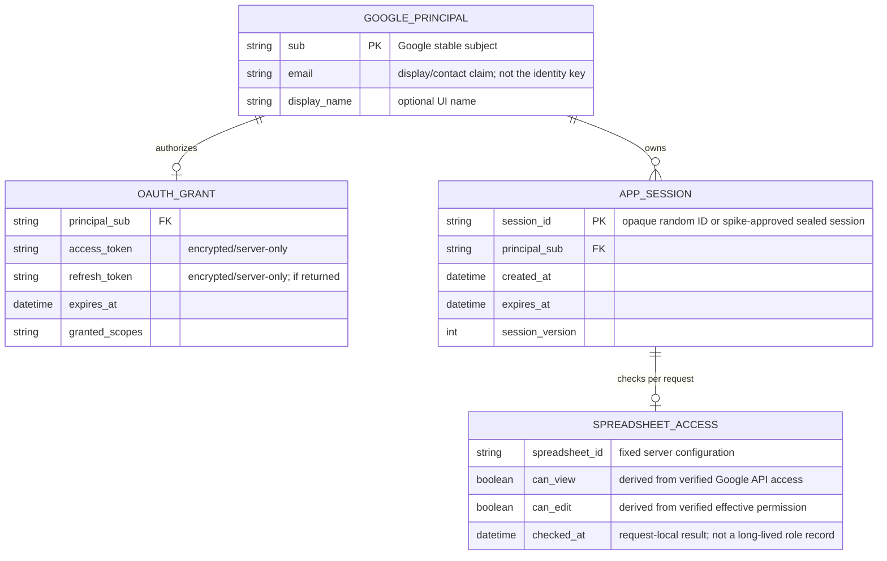
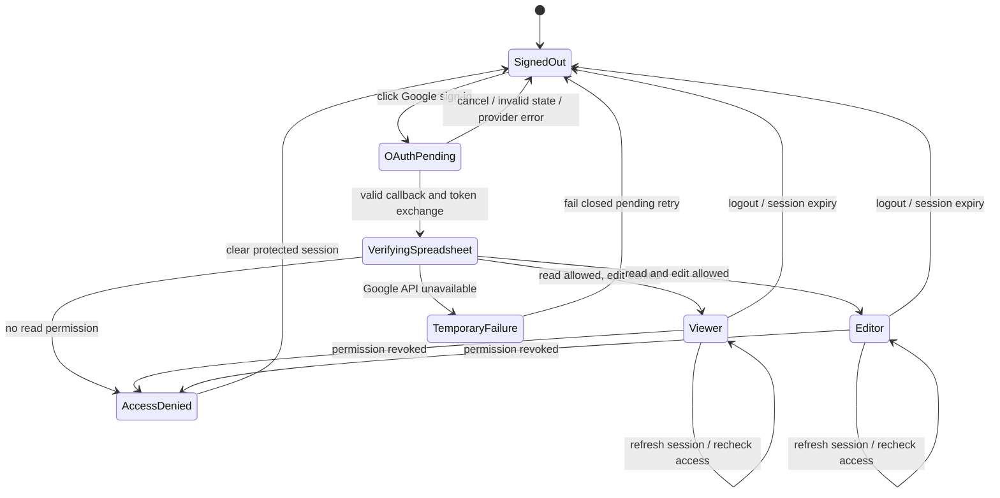

# Google Sheets Access Feature — Implementation Plan

## Goal

Allow users to sign in with Google and access the badminton application only when their Google account can access the one configured Google Spreadsheet. Preserve Google as the source of truth for read and edit permissions: viewers can read, while editors can mutate data through server-side handlers. Keep delegated OAuth credentials out of client-accessible code and use session/token handling that remains safe across Vercel runtime instances. Provide explicit handling for missing access, revoked permission, expired credentials, and temporary Google service failures.

## Requirements

### Feature requirements

- Require Google sign-in before returning any application or spreadsheet data.
- Verify access to the server-configured Spreadsheet ID using the signed-in user's delegated OAuth credential; reject client-supplied Spreadsheet IDs.
- Permit a user with read access to view data but reject every write request from a viewer on the server.
- Permit writes only when both the Google spreadsheet permission and required OAuth scope allow them.
- Identify users by Google's stable `sub` claim, not by email alone.
- Validate OAuth `state` and callback data; do not create an application session after canceled consent, invalid state, token-exchange failure, or failed spreadsheet access verification.
- Recheck authorization on protected data operations and fail closed after permission revocation; distinguish authorization denial from transient Google API failure.
- Support secure logout, token expiry, refresh where approved, and re-consent when the token is revoked or cannot be refreshed.
- Keep OAuth client secrets, authorization codes, access tokens, refresh tokens, and session secrets out of browser JavaScript, URLs, application data sheets, and logs.
- Use `HttpOnly`, `Secure` under HTTPS, and an OAuth-compatible `SameSite` cookie policy.
- Support Vercel Preview and Production with separate environment configuration and correctly registered OAuth redirect URIs.
- Meet the PRD's login/session target of five seconds under normal conditions, excluding user interaction on Google's consent screen.

### Implementation specifics

- Complete [the Google OAuth permission spike](../../../../spikes/security-google-oauth-spreadsheet-permissions-spike.md) before selecting scopes, permission-detection behavior, token persistence, or refresh strategy.
- Resolve the spike's storage decision for Vercel before implementing the application session. Do not keep sessions, tokens, role state, or authorization decisions in module-level memory.
- Use the `googleapis` Node.js client for OAuth and the Google APIs selected by the spike; use the Node.js runtime for handlers that depend on Node-specific Google client code.
- Use the Data Access Layer (DAL) as the sole application boundary for session lookup, spreadsheet access checks, and safe user DTOs.
- Use Next.js App Router Route Handlers for login start, OAuth callback, logout, and safe session inspection. Do not add tRPC, Stack Auth, a local password system, or a shared service account.
- Treat the spreadsheet's Google permissions and Google API responses as authoritative. A UI read-only state is a usability affordance, not an authorization control.

## Technical Considerations

### System Architecture Overview

```mermaid
flowchart LR
  subgraph FRONTEND["Frontend Layer · Next.js App Router"]
    Login["Login page"]
    Protected["Protected layout and pages"]
    LoginButton["Google sign-in button"]
    SessionUI["Account menu and read-only banner"]
    AuthState["Safe session DTO state"]
    Login --> LoginButton
    Protected --> SessionUI
    SessionUI --> AuthState
  end

  subgraph API["API Layer · Vercel Node.js Route Handlers"]
    Start["GET /api/auth/google"]
    Callback["GET /api/auth/google/callback"]
    SessionRoute["GET /api/auth/session"]
    Logout["POST /api/auth/logout"]
    Guards["requireSpreadsheetReadAccess / requireSpreadsheetEditAccess"]
    Start --> Callback
    SessionRoute --> Guards
    Logout --> Guards
  end

  subgraph DOMAIN["Business Logic and Data Access Layer · server-only"]
    OAuthService["Google OAuth service"]
    SessionService["Session and token service"]
    AccessService["Spreadsheet permission service"]
    SafeDTO["Minimal user/access DTO"]
    OAuthService --> SessionService
    SessionService --> AccessService
    AccessService --> SafeDTO
  end

  subgraph DATA["External Identity and Data"]
    GoogleOAuth["Google OAuth 2.0"]
    DriveAPI["Google Drive API<br/>effective capabilities if verified by spike"]
    SheetsAPI["Google Sheets API<br/>configured Spreadsheet ID only"]
    TokenStore["Approved server-only durable token/session storage<br/>or spike-approved sealed session"]
  end

  subgraph INFRA["Infrastructure Layer"]
    Vercel["Vercel Preview and Production"]
    Env["Environment variables<br/>OAuth client, redirect URI, Spreadsheet ID, session secret"]
  end

  LoginButton -->|"navigate"| Start
  Start -->|"302 authorization URL + state"| GoogleOAuth
  GoogleOAuth -->|"code and state"| Callback
  Callback -->|"exchange code"| OAuthService
  OAuthService -->|"delegated token"| DriveAPI
  OAuthService -->|"verify read access"| SheetsAPI
  SessionService <-->|"encrypted/server-only credentials"| TokenStore
  Protected -->|"request-time session read"| SessionRoute
  SessionRoute --> Guards
  Guards --> AccessService
  SafeDTO -->|"identity and canRead/canEdit only"| AuthState
  Callback -->|"set secure cookie; redirect"| Protected
  Vercel --> API
  Vercel --> FRONTEND
  Env -.-> Vercel
```



**Request flow:**

1. The login page sends the browser to `GET /api/auth/google`. The handler creates a one-time OAuth state value and redirects to Google's authorization endpoint.
2. Google returns the authorization code and state to the registered callback. The callback validates state, exchanges the code on the server, and verifies read access to the configured spreadsheet.
3. The server uses the permission-detection method proved by the security spike to determine viewer/editor status. It creates a session only after read access is confirmed.
4. Protected pages and data handlers call the server-only DAL. A viewer receives read access and cannot pass any write guard; an editor still requires a successful Google write.
5. If Google reports revoked/insufficient permission, the DAL denies access and clears or restricts the session according to the tested spike decision. Temporary Google outages return an explicit service error, not an authorization result or empty data.

### Technology Stack Selection

| Layer | Selection | Rationale |
|---|---|---|
| UI and routing | Existing Next.js 16.4.6 App Router, React 19, TypeScript strict mode | The repository already uses this stack; no monorepo or framework migration is needed. |
| HTTP interface | Next.js Route Handlers using Web `Request`/`Response` | Matches the parent architecture and the installed Next.js Route Handler guide. |
| Google OAuth and API client | `googleapis` Node.js client, with scopes fixed by the completed security spike | Reuses Google's maintained OAuth, Drive, and Sheets clients; no access token is sent to client code. |
| Authorization | Server-only DAL functions and Google effective file permissions | Google spreadsheet sharing remains the source of truth; client role values are never trusted. |
| Session/token storage | The durable or sealed-session method selected and tested in the security spike | Vercel instances do not share process memory. The implementation must not invent a storage strategy independently of the spike. |
| Styling | Existing Tailwind CSS 4 and accessible semantic HTML | Already installed; shadcn/ui is not installed and is not required by the repository architecture. |
| Tests | Vitest for pure auth/permission logic; Playwright for browser and protected-page flows | The installed Next.js guide notes that async Server Components should be covered with E2E tests. |
| Hosting | Vercel Preview and Production | The parent architecture names Vercel as the target and requires environment separation. |

**Explicit exclusions:** Do not use Stack Auth, tRPC, PostgreSQL, Redis, Docker, or a shared service account for this feature. The repository architecture explicitly uses delegated Google OAuth and one business-data spreadsheet. Add a separate durable token/session service only if the security spike proves it is required and the architecture is updated.

### Integration Points

- **Google OAuth 2.0:** Authorization-code flow with validated `state`; request only the identity and spreadsheet scopes approved in the security spike.
- **Google Drive API:** Use `files.get` capability fields such as `canView` and `canEdit` only if the spike proves they correctly represent the tested sharing modes.
- **Google Sheets API:** Read only the configured Spreadsheet ID to verify access. Every later business-data operation must continue to use the signed-in user's delegated credential.
- **Vercel environment configuration:** `GOOGLE_CLIENT_ID`, `GOOGLE_CLIENT_SECRET`, `GOOGLE_REDIRECT_URI`, `GOOGLE_SPREADSHEET_ID`, and `SESSION_SECRET` are server-only. Add variables for an approved token store only if the spike requires them.
- **Business Route Handlers:** Call `requireSpreadsheetReadAccess` before data reads and `requireSpreadsheetEditAccess` before mutations. The final Google API response remains authoritative for write success.
- **Error contract:** Return a safe error code and user-facing message; never return OAuth provider error details, tokens, raw credentials, or spreadsheet contents.

### Deployment Architecture

- Deploy the Next.js application to Vercel Preview first, then Production after test-account validation.
- Use separate Preview and Production environment variables. Preview must point to a disposable spreadsheet and non-production OAuth client unless the Google OAuth setup explicitly restricts the same client safely.
- Register each used callback URL in the corresponding Google OAuth client. Do not assume arbitrary Preview deployment URLs are authorized.
- Keep all OAuth and session secrets out of `NEXT_PUBLIC_*`, source control, spreadsheet cells, browser storage, URL query parameters, and logs.
- Implement all Google OAuth/Drive/Sheets handlers in the Node.js runtime; do not opt into Edge runtime without a separately verified compatible client and storage approach.
- Docker and a self-hosted application server are not part of this feature's deployment plan.

### Scalability Considerations

- Treat every Vercel invocation as independent: session/token lookup and access checks must work across instances and after restarts.
- Do not cache user identity, `canEdit`, access tokens, or authorization outcomes in process memory or in a shared static Next.js cache.
- Set authentication responses to `Cache-Control: private, no-store`; session inspection and protected data are request-specific.
- With `cacheComponents: true`, read request-time session state only in the documented dynamic/Suspense pattern; do not make a protected layout's top-level render block the entire static shell.
- Keep access checks bounded to the configured spreadsheet and minimum required Drive/Sheets requests. Measure login and authorization latency against the five-second PRD target.
- Do not add a process-local rate limiter. Use one-time short-lived OAuth state and Vercel platform protections; introduce a shared limiter only if measured abuse or deployment requirements justify an architecture decision.

### Database Schema Design

This feature does not create SQL tables or write authentication records to the business spreadsheet. The following ERD is a logical server-side model; persistence of grants and sessions must follow the completed security spike.



#### Logical entity specifications

| Entity | Fields and constraints | Storage and lifecycle |
|---|---|---|
| `GOOGLE_PRINCIPAL` | `sub` is required and stable; email and display name are optional profile claims and are not authorization keys. | Minimal session identity only; do not create a separate local user directory. |
| `OAUTH_GRANT` | Access token, optional refresh token, expiry, and granted scopes; tokens must be encrypted at rest if stored. | Server-only persistence selected by the security spike; never stored in Google Sheets or returned to the browser. |
| `APP_SESSION` | Opaque high-entropy session ID, principal reference, creation/expiry timestamps, and version for invalidation. | Secure cookie plus server-side store, or other spike-approved stateless/sealed model; no Vercel process memory. |
| `SPREADSHEET_ACCESS` | Configured Spreadsheet ID, `canView`, `canEdit`, and check timestamp. | Derived per request or request-scoped only; do not persist a stale role as the source of truth. |
| `OAUTH_STATE` | Random state, issue time, callback binding, and one-use status. | Short-lived, one-time cookie/state mechanism; invalidate after callback or expiry. |

#### Indexing and relationships

- No SQL database or SQL indexes are introduced. If the security spike requires a durable session provider, use its native unique key for the opaque session ID and a unique index for Google `sub`; document the exact provider schema before enabling it.
- `OAUTH_GRANT.principal_sub` and `APP_SESSION.principal_sub` refer to the stable Google `sub`; email changes must not orphan sessions.
- `SPREADSHEET_ACCESS` is a derived authorization result, not a stored foreign-key record or independent ACL.
- Do not create spreadsheet tabs for OAuth users, sessions, tokens, or permissions.

#### Migration strategy

- No relational database migration is needed for this feature.
- Version the server-side session envelope with `session_version`; reject and clear sessions with unknown or retired versions.
- If the spike selects a durable token/session provider, version its record shape and define a rollback-safe deployment before enabling it in Production.
- The business spreadsheet's tab/header migration remains governed by the parent Google Sheets schema setup, not by this authentication feature.

### API Design

All endpoints are App Router Route Handlers under `app/api/auth/`. OAuth and session endpoints use `Cache-Control: private, no-store`. No endpoint returns Google access/refresh tokens.

| Method and path | Request | Success response | Authorization and behavior |
|---|---|---|---|
| `GET /api/auth/google` | No body. Optional safe `returnTo` limited to local application paths. | `302` redirect to Google authorization URL. | Creates one-time `state`; uses only scopes approved by the security spike; rejects external redirect URLs. |
| `GET /api/auth/google/callback` | Google `code` and `state`, or Google cancellation/error query. | `302` to Dashboard on verified access; otherwise `302` to Login with a safe error code. | Validates and consumes state, exchanges code server-side, verifies access to `GOOGLE_SPREADSHEET_ID`, determines viewer/editor status, and creates a session only on verified read access. |
| `GET /api/auth/session` | No body. | `200` safe `AuthSessionDTO`; `401` if no valid session. | Revalidates session and current spreadsheet access; returns only identity display fields, `canRead`, `canEdit`, and expiry. Never returns tokens or scopes that reveal credentials. |
| `POST /api/auth/logout` | Empty body; same-origin request. | `204` and expired application session cookie. | Requires valid CSRF/origin handling; destroys the app session and follows the spike's token-retention/revocation policy. |

#### Type contracts

```ts
type AuthSessionDTO = {
  user: {
    googleSubject: string;
    email: string | null;
    displayName: string | null;
  };
  access: {
    canRead: true;
    canEdit: boolean;
  };
  expiresAt: string;
};

type AuthErrorCode =
  | "INVALID_OAUTH_STATE"
  | "CONSENT_CANCELLED"
  | "SPREADSHEET_ACCESS_DENIED"
  | "READ_ONLY"
  | "SESSION_EXPIRED"
  | "OAUTH_REAUTH_REQUIRED"
  | "GOOGLE_TEMPORARY_FAILURE";

type AuthErrorDTO = {
  error: {
    code: AuthErrorCode;
    message: string;
  };
};
```

#### Status and error behavior

- `302`: OAuth redirects and callback completion; callback redirects use allowlisted local paths only.
- `204`: logout succeeded and local session cookies were cleared.
- `400`: malformed callback or invalid/expired/replayed OAuth state.
- `401`: missing/expired application session or re-authentication required.
- `403`: account cannot read the configured spreadsheet, or a viewer attempts a write.
- `429`: return only when an actual shared/platform rate-limit decision is configured; do not implement a per-instance limiter.
- `502` or `503`: Google OAuth/Drive/Sheets dependency failure; do not convert it to no-access or empty data.
- `500`: unexpected internal failure with a correlation ID; no provider payload or secret in the response.

#### Caching and rate limiting

- Mark session and OAuth responses `private, no-store`; do not use `use cache` for cookies, tokens, permission results, or protected response bodies.
- Do not statically prerender authorization-dependent output.
- Consume OAuth `state` once and expire it promptly. Use Vercel platform protection for request abuse; any persistent rate-limit store requires a separate documented dependency and threat-model update.

### Frontend Architecture

#### Component Hierarchy Documentation

```text
RootLayout (app/layout.tsx)
└── AuthLayout (app/(auth)/layout.tsx)
    └── LoginPage (app/(auth)/login/page.tsx)
        ├── LoginStatusAlert
        └── GoogleLoginButton

ProtectedLayout (app/(protected)/layout.tsx)
└── Suspense boundary for request-time auth
    └── AppShell (src/components/app-shell.tsx)
        ├── MainNavigation
        ├── AccountMenu
        │   └── LogoutButton
        ├── ReadOnlyBanner (only when canEdit is false)
        └── Protected page children
```

- Use server components for page/layout composition and protected data access. Use client components only for interactive login/logout controls, accessible status alerts, and local form states.
- Reuse existing Tailwind CSS 4; use semantic HTML and accessible labels/focus states. Do not add shadcn/ui solely because the generic template mentions it.
- Login errors are mapped from a strict allowlist of safe query codes; never render raw Google error query values.
- Hide or disable write affordances for viewers, but keep server guards authoritative.

#### State Flow Diagram



#### Reusable components and state management

- `GoogleLoginButton`: navigates to the OAuth start endpoint; disables repeat clicks while navigation starts.
- `LoginStatusAlert`: maps safe auth error codes to localized explanatory messages and an actionable retry.
- `ReadOnlyBanner`: displays read-only status without implying that client state grants permission.
- `AccountMenu`: shows the minimal Google profile and a POST logout action.
- `AuthSessionDTO`: server-derived identity and current access flags; no access or refresh token is included.
- Avoid Zustand and React Query for this feature. The session is obtained server-side per request; short-lived UI state is local React state. If interactive components need session information, pass only `AuthSessionDTO` from the server.

### Security and Performance

#### Authentication and authorization

- Validate OAuth `state` with cryptographically random, single-use, short-lived state. Bind the callback to the initiating browser; use PKCE if supported by the selected OAuth flow.
- Use a stable Google `sub` as the principal identifier; do not authorize by email, UI role, client-provided `canEdit`, or OAuth scope alone.
- Use least-privilege scopes selected by the security spike. A write scope does not prove that the user has edit permission on this spreadsheet.
- Check spreadsheet access on callback and protected operations. For writes, enforce edit permission on the server and treat Google API rejection as final.
- Use `HttpOnly`, `Secure` in HTTPS, `SameSite=Lax` or the flow-compatible value approved by the spike, `Path=/`, and explicit expiration. Logout is a same-origin POST.
- Redact `code`, `state`, tokens, session cookies, Spreadsheet ID, and sheet contents from logs and error reporting.
- Fail closed on expired, malformed, revoked, or unverifiable sessions. Do not turn temporary Google failures into unauthorized status or successful empty responses.

#### Data validation and privacy

- Validate callback query fields and local return paths before processing.
- Validate configured Google IDs and OAuth redirect URI at server startup; never accept Spreadsheet ID or OAuth scopes from the browser.
- Return allowlisted profile fields only. Do not serialize provider token objects into React props, HTML, API responses, logs, or analytics.
- Clear protected data from the active view after a confirmed permission revocation or logout.

#### Performance and reliability

- Target login/session verification at p95 ≤ 5 seconds excluding Google consent interaction, matching the PRD.
- Limit the callback permission check to the minimum API calls proven by the spike; reuse the current delegated client during one request, not across unrelated users.
- Do not cache authorization, session, or token data across users or requests. `Cache-Control: private, no-store` applies to auth endpoints.
- Distinguish `403` permission failures from `429`, `5xx`, timeouts, and network failures; retry only safe token refresh or read operations and never silently retry a non-idempotent write here.
- Emit structured, redacted diagnostic events with a correlation ID and error category; omit OAuth codes, tokens, and spreadsheet contents.

## Implementation Plan

### Phase 1 — Resolve OAuth and Vercel decisions

1. Complete `docs/spikes/security-google-oauth-spreadsheet-permissions-spike.md` using disposable editor, viewer, and no-access accounts and a disposable spreadsheet.
2. Record approved OAuth scopes, effective permission detection, refresh-token behavior, revocation handling, session/token persistence, consent-screen prerequisites, and Preview/Production callback configuration.
3. Update the parent architecture and this plan if the spike requires a durable session/token provider. Do not implement authentication against an unresolved storage or permission strategy.

**Exit criteria:** the spike status is Complete, its success criteria pass, and the chosen session/token method works across independent Vercel invocations.

### Phase 2 — Add server configuration, OAuth, and session services

1. Add `googleapis` to `package.json` and `yarn.lock`; add `src/server/env.ts` validation for `GOOGLE_CLIENT_ID`, `GOOGLE_CLIENT_SECRET`, `GOOGLE_REDIRECT_URI`, `GOOGLE_SPREADSHEET_ID`, and `SESSION_SECRET`.
2. Implement `src/server/auth/types.ts`, `src/server/auth/scopes.ts`, and `src/server/auth/google-oauth.ts` with `createAuthorizationUrl`, `exchangeAuthorizationCode`, and `refreshGoogleToken`. Populate scopes only from the completed spike.
3. Implement `src/server/auth/session.ts` with `createSession`, `getSession`, `destroySession`, and cookie configuration using the spike-approved cross-instance storage method.
4. Mark OAuth, session, permission, and Google client modules `server-only`; declare Node.js runtime in handlers that use Node-specific Google libraries.

**Exit criteria:** unit tests pass for state validation, code exchange failure, session creation, expiry, refresh, logout, and secret redaction.

### Phase 3 — Enforce spreadsheet permissions through the DAL

1. Implement `src/server/auth/authorization.ts` with `getCurrentUser`, `requireSpreadsheetReadAccess`, and `requireSpreadsheetEditAccess`.
2. Verify access only against `GOOGLE_SPREADSHEET_ID`. Use the Drive capability check only if the spike demonstrated reliable `canView`/`canEdit` behavior; otherwise follow the tested Google API enforcement method.
3. Create `src/server/errors.ts` auth error types and map no access, viewer write, revoked permission, expired consent, and temporary Google failure to distinct safe outcomes.
4. Add `app/api/auth/session/route.ts` returning `AuthSessionDTO` without any token or provider object.

**Exit criteria:** owner/editor, viewer, and no-access test cases produce the expected server outcomes; no access decision depends on client-provided values.

### Phase 4 — Add Route Handlers and accessible login UI

1. Add `app/api/auth/google/route.ts` for OAuth initiation, `app/api/auth/google/callback/route.ts` for callback validation and access verification, and `app/api/auth/logout/route.ts` for same-origin POST logout.
2. Add `app/(auth)/layout.tsx` and `app/(auth)/login/page.tsx`; implement `src/components/auth/google-login-button.tsx` and `src/components/auth/login-status-alert.tsx`.
3. Add `app/(protected)/layout.tsx`, `src/components/app-shell.tsx`, `src/components/main-navigation.tsx`, `src/components/auth/account-menu.tsx`, and `src/components/auth/read-only-banner.tsx`.
4. Update `app/layout.tsx` for Indonesian metadata and document language. Follow the installed `authentication-with-cache-components.md` guide: place request-time session access within a Suspense boundary and do not read session data at the top level of a static-shell layout.
5. Protect every future page and Route Handler through the DAL; use the UI's `canEdit` flag only to render a read-only affordance.

**Exit criteria:** login, callback, safe session inspection, logout, viewer mode, and access-denied screens work without exposing sensitive data.

### Phase 5 — Verify and configure deployment

1. Add `tests/unit/auth/` tests for OAuth state, session expiry, token refresh, permission errors, and redaction; add Playwright auth-flow tests using a test-only fixture.
2. Add `docs/setup/google-oauth.md` with Google Cloud configuration, exact approved scopes, test-user setup, redirect URI registration, and session/token operations. Do not include secrets.
3. Configure Vercel Preview with a non-production OAuth client and disposable spreadsheet; configure Production variables only after Preview passes.
4. Run `yarn lint`, `yarn test:unit`, `yarn test:e2e`, and `yarn build`; manually verify Google editor, viewer, no-access, and permission-revocation behavior with test accounts.

**Exit criteria:** all automated tests and build gates pass; Preview confirms correct callbacks, cross-instance session continuity, viewer/editor enforcement, and no token in browser assets or logs.

## Files

- `package.json` and `yarn.lock` — Google API and approved session/test dependencies.
- `src/server/env.ts` — validated server-only environment configuration.
- `src/server/auth/types.ts` — safe identity, session, and access types.
- `src/server/auth/scopes.ts` — Google OAuth scopes selected by the completed spike.
- `src/server/auth/google-oauth.ts` — authorization URL, code exchange, refresh, and provider error handling.
- `src/server/auth/session.ts` — Vercel-compatible session/token persistence and secure cookies.
- `src/server/auth/authorization.ts` — spreadsheet access checks and route guards.
- `src/server/errors.ts` — safe typed authentication and authorization errors.
- `app/api/auth/google/route.ts` — OAuth initiation.
- `app/api/auth/google/callback/route.ts` — callback, token exchange, and access verification.
- `app/api/auth/session/route.ts` — safe session DTO.
- `app/api/auth/logout/route.ts` — same-origin logout.
- `app/(auth)/layout.tsx` and `app/(auth)/login/page.tsx` — public login surface.
- `app/(protected)/layout.tsx` — protected app shell and dynamic session boundary.
- `app/layout.tsx` — document language and application metadata.
- `src/components/auth/google-login-button.tsx`, `login-status-alert.tsx`, `account-menu.tsx`, and `read-only-banner.tsx` — reusable authentication UI.
- `src/components/app-shell.tsx` and `src/components/main-navigation.tsx` — authenticated navigation shell.
- `tests/unit/auth/` and `tests/e2e/auth.spec.ts` — unit and browser-level coverage.
- `docs/setup/google-oauth.md` and `.env.example` — safe operational setup guidance.
- `docs/ways-of-work/plan/pencatatan-sesi-badminton/arch.md` — update only if verified spike findings change the current deployment/session architecture.

## Acceptance Criteria

- A Google user with read permission can sign in and read protected data; a user without read permission cannot obtain an application session.
- A viewer sees read-only UI and every direct server write attempt is rejected.
- An editor can proceed only when both spreadsheet edit permission and the required OAuth grant are present.
- Invalid, expired, or replayed OAuth state cannot create a session.
- Revoked spreadsheet access and revoked OAuth consent stop subsequent protected access; temporary Google outages are reported as temporary failures.
- Tokens never appear in browser JavaScript, URLs, React props, API responses, logs, or the business spreadsheet.
- Session and token access remain correct across Vercel instances and process restarts using the spike-approved storage method.
- Login and session checks meet the five-second PRD target under normal Google API conditions, excluding user consent interaction.
- `yarn lint`, `yarn test:unit`, `yarn test:e2e`, and `yarn build` pass.

## Related Specifications / Further Reading

- [Google Sheets access Feature PRD](./prd.md)
- [Parent Epic PRD](../epic.md)
- [Parent architecture](../arch.md)
- [Full badminton MVP implementation plan](../feature-badminton-mvp-1.md)
- [Google OAuth permission spike](../../../../spikes/security-google-oauth-spreadsheet-permissions-spike.md)
- [Installed Next.js Route Handlers guide](../../../../../node_modules/next/dist/docs/01-app/01-getting-started/15-route-handlers.md)
- [Installed Next.js authentication with Cache Components guide](../../../../../node_modules/next/dist/docs/01-app/02-guides/authentication-with-cache-components.md)
- [Installed Next.js data security guide](../../../../../node_modules/next/dist/docs/01-app/02-guides/data-security.md)
- [Installed Next.js environment variables guide](../../../../../node_modules/next/dist/docs/01-app/02-guides/environment-variables.md)
- [Google OAuth 2.0 for Web Server Applications](https://developers.google.com/identity/protocols/oauth2/web-server)
- [Google Sheets API scopes](https://developers.google.com/workspace/sheets/api/scopes)
- [Google Drive API file capabilities](https://developers.google.com/workspace/drive/api/reference/rest/v3/files#File)
- [Vercel Functions](https://vercel.com/docs/functions)
